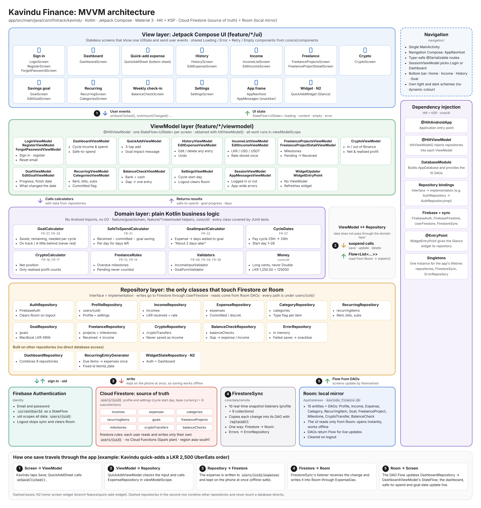

# Kavindu Finance

An Android personal finance app built for one person: **Kavindu Silva**, a 25-year-old junior software engineer in Colombo. In 12 months he earned over LKR 1.6 million from four irregular sources: a salary that changes every month, freelance projects paid in milestones, Google AdSense paid in USD, and crypto trading on Binance. Yet he saved only LKR 11,200 and cannot say where the rest went. Every earlier tool (a Google Sheet, a USD-only budgeting app, a notes app, his bank's summary) was abandoned within two weeks. This app is built so he keeps using it: entry takes seconds, recurring bills are added for him, nothing turns red or shames him, and missing a few days never makes it look broken. It ties every rupee to his goal of LKR 490,000 for a MacBook Pro within 12 months.

SE3092 Assignment 01 · Kotlin · Jetpack Compose · Material 3 · MVVM · Firebase Authentication · Cloud Firestore · Room

## Features

| Feature | Kavindu's problem it solves |
| --- | --- |
| Login and register (email and password) | His data must follow him to any phone and stay private. Firebase Authentication plus security rules mean only he can read his data. |
| Add income in LKR, USD or USDT | He earns from four sources in three currencies and "cannot answer" what he earns. For USD and USDT he enters the LKR that reached his bank; the rate is worked out once and stored, so a later rate never changes past income. |
| Quick-add expense (3 taps) | Every tracking attempt died because entry was too slow. Amount, category, Save, straight from the dashboard. The most-used categories come first, and the last channel and account are remembered. |
| Committed vs discretionary categories | He has "no concept" of what share of his spending is rent and bills versus coffee and UberEats. Every category carries that flag, so the dashboard splits his spending in two. |
| Recurring items and subscription review | His gym auto-debits from a secondary account and he forgot to cancel two subscriptions. Rent, gym and subscriptions are added each cycle for him, utilities as an estimate to confirm, and subscriptions not reviewed for 60 days get a gentle nudge. |
| Savings goal | The MacBook goal was "emotionally present and financially invisible". The goal screen shows saved so far, needed this cycle, the projected finish date, and what moved that date. |
| Goal impact message | Daily spending never felt connected to the goal. After each discretionary expense he sees how many days it moves his goal date, for example "UberEats LKR 2,500 ≈ 2 days later". |
| Safe to spend | He needs one number he can act on. Income minus committed and discretionary spending minus this cycle's goal saving, shown as a total and as a per-day amount for the days left. |
| Dashboard with live updates and category chart | He has never seen where his money goes. One screen shows this cycle's income, spending, the two-bucket split, a category chart and goal progress, updating the moment anything is saved. |
| Transaction history | He once found LKR 24,000 of coffee and dining only by reading three months of statements. Every entry can be seen, edited or deleted, grouped by date. |
| Pay-cycle setting | His salary arrives on the 25th, so a calendar month is the wrong unit. "My month starts on day …" (default 25, limited to 1–28) drives every total in the app. |
| Freelance projects (Pending → Received) | He twice forgot to follow up on invoices and could not match payments to projects. Milestones show overdue invoices on the dashboard, and marking one received creates the linked income entry. |
| Crypto card | He has no running net position after a Q1 gain and a Q3 loss. Money moved into and out of Binance gives his net position and realised profit, which is calculated and never saved as income, so it is never counted twice. |
| Weekly balance check | Cash, PickMe rides and the secondary account never reach any record. Once a week he enters his bank balance and wallet cash; any gap becomes one honest "unrecorded spending" entry instead of a broken total. |
| Home-screen widget | Opening the app is the step he skips. A 4×1 widget shows "Safe to spend today" and an **Add expense** button that opens quick-add directly. |

## Tech stack

| Area | Technology and version |
| --- | --- |
| Language | Kotlin 2.4.21 (100% Kotlin, no Java files) |
| Build | Android Gradle Plugin 9.4.1, Gradle 9.6.0, Gradle Kotlin DSL, version catalog (`gradle/libs.versions.toml`) |
| Code generation | KSP 2.3.12 (no kapt) |
| UI | Jetpack Compose, Compose BOM 2026.02.01, Material 3, Material Icons Extended. Our own light and dark colour schemes, no dynamic colour. |
| Navigation | Navigation Compose 2.10.2, single activity, type-safe `@Serializable` routes |
| Dependency injection | Hilt 2.60.1, hilt-navigation-compose 1.4.0 |
| Cloud | Firebase BoM 35.0.2: Firebase Authentication and Cloud Firestore (source of truth). google-services plugin 4.5.0 |
| Local database | Room 2.8.5 (offline mirror the screens read from) |
| Async | Kotlin coroutines and `StateFlow`; kotlinx-coroutines-play-services 1.11.0 for `.await()` on Firebase tasks |
| Widget | Jetpack Glance 1.2.0 (glance-appwidget, glance-material3) |
| Tests | JUnit 4.13.2: unit tests for every money, date, goal and rule calculation |
| Android versions | minSdk 26 (Android 8.0), targetSdk 37, compileSdk 37 |

## Architecture



Every screen follows the same MVVM path, and nothing skips a layer:

```
Screen (Compose)  →  ViewModel (one StateFlow<UiState>)  →  Repository  →  Firestore / Room
```

- **Screen:** a Composable that only shows its `UiState` and calls event functions such as `onSaveClicked()`. There are no calculations and no repository calls in Composables.
- **ViewModel:** one `UiState` data class per screen, exposed as one read-only `StateFlow`. It is obtained with `hiltViewModel()`, and all its async work runs in `viewModelScope`. Money and date calculations live in plain Kotlin classes (for example `SafeToSpendCalculator`, `GoalCalculator`, `BalanceCheckCalculator`) that the ViewModels call and the unit tests check.
- **Repository:** the only classes that touch Room or Firestore. They are interfaces in `core/data/repository` with Hilt-bound implementations.
- **Hilt** builds everything: `@HiltAndroidApp` application, `@AndroidEntryPoint` activity, `@HiltViewModel` ViewModels, and modules in `core/di` for Firebase, the Room database and the repositories.

How one save travels through the app:

1. The user taps Save. The screen calls an event on its ViewModel, for example `onSaveClicked()`.
2. The ViewModel checks the input with a plain Kotlin validator and calls the repository inside `viewModelScope`.
3. The repository writes to **Firestore** through `UserFirestore`. The save does not wait for the server: Firestore keeps it on the phone at once, so saving also works offline. If the server later rejects it, Firestore undoes it and the app shows a calm message.
4. **`FirestoreSync`** (`core/data/remote`) keeps 10 real-time snapshot listeners while a user is signed in: one on the profile document and one on each of the 9 collections. It copies every change into the matching **Room** table.
5. Room returns a `Flow`, the ViewModel turns it into its `StateFlow`, and the screen updates by itself, on this phone and on any other signed-in device.

Design rules the code follows:

- **Firestore is the source of truth, Room is the local mirror.** Screens read only from Room (`kavindu_finance.db`), so they open instantly and never go blank without a network. Logout stops the listeners and clears Room, so the next person on the phone cannot see the data.
- **Money is `Long` cents**, never `Double` (LKR 1,250.50 = `125050`), so totals never drift.
- **The month is a pay cycle** (25th to 24th by default), not a calendar month.
- **All calculations run on the phone** in plain Kotlin classes with unit tests. There are no Cloud Functions, so the project stays on the free Spark plan.
- Every screen has loading, error (with retry) and empty states, using the shared components in `core/ui/components`.

### Firestore data

All of a user's data lives under their own document, `users/{uid}`, with the sub-collections `incomes`, `expenses`, `categories`, `recurringItems`, `goals`, `freelanceProjects`, `milestones`, `cryptoTransfers` and `balanceChecks`.

- **Multi-currency income:** each income stores the original amount and currency, the LKR amount that actually arrived, and the rate worked out at save time. Past entries are never recalculated.
- **Security rules** (`firestore.rules`): a signed-in user can read and write only their own `users/{uid}/...` data. Every save is also checked: exact fields, whole-number cents, a valid currency and date, and the data rules. For example, a recurring entry must use its fixed ID such as `rent_2026-10-25`, so it can never be added twice, and a past balance check can never be edited.
- **Indexes** (`firestore.indexes.json`): no composite indexes are needed. The app only listens to whole collections under `users/{uid}`, and all filtering and sorting (by pay cycle, project, overdue status) happens in Room, which has its own indexes on those columns.

## Firebase configuration

The repository already contains `app/google-services.json` for the team's Firebase project, so a team member can build straight away. To run the app against your own Firebase project instead:

1. Create a project in the [Firebase console](https://console.firebase.google.com/). The free Spark plan is enough.
2. Add an Android app with the package name **`com.fintrack.kavindu`**.
3. Add the **SHA-1 fingerprints** of your debug and release signing keys. From a terminal in the project folder run:

   | Windows | macOS / Linux |
   | --- | --- |
   | `.\gradlew.bat signingReport` | `./gradlew signingReport` |

   Copy the `SHA1` line from the `Variant: debug` block and from the `Variant: release` block. The release one only appears once release signing is set up (see [Release APK](#release-apk)). Add both in **Project settings → Your apps → Add fingerprint**.
4. Download the app's `google-services.json` and put it in the `app/` folder, replacing the existing one.
5. In **Authentication → Sign-in method**, enable **Email/Password**.
6. In **Firestore Database**, create a database in production mode, location **`asia-south1` (Mumbai)**.
7. Deploy the security rules and indexes from the repository with the [Firebase CLI](https://firebase.google.com/docs/cli):

   ```
   firebase login
   firebase use --add          (choose your project)
   firebase deploy --only firestore:rules,firestore:indexes
   ```

   Without this step the database denies everything, and registering fails.

## Build and run

**Requirements:** Android Studio (latest stable), an emulator or phone with Android 8.0 or newer, and an internet connection for the first build.

**Java:** Gradle runs on **Java 25** (`gradle/gradle-daemon-jvm.properties`). You don't need to install it: Gradle finds a full JDK 25 on your computer or downloads one by itself on the first build, on Windows and macOS alike. The app code itself compiles to Java 11.

> Make sure no Java 25 runtime **without `jlink`** is installed, such as the one bundled with VS Code's Java extension. Gradle may pick it and the build fails with "jlink executable ... does not exist". If that happens, remove that runtime (or install a full JDK 25, for example Temurin 25), then run `gradlew --stop` and build again.

Then:

1. Clone the repository and open the folder in Android Studio. Let Gradle sync.
2. Start an emulator or connect a phone.
3. Press **Run**, or use a terminal in the project folder:

   | Task | Windows | macOS / Linux |
   | --- | --- | --- |
   | Build a debug APK | `.\gradlew.bat assembleDebug` | `./gradlew assembleDebug` |
   | Install on the running device | `.\gradlew.bat installDebug` | `./gradlew installDebug` |
   | Run the unit tests | `.\gradlew.bat testDebugUnitTest` | `./gradlew testDebugUnitTest` |
   | Build a signed release APK | `.\gradlew.bat assembleRelease` | `./gradlew assembleRelease` |
   | Show the SHA-1 fingerprints | `.\gradlew.bat signingReport` | `./gradlew signingReport` |

- The debug APK is written to `app/build/outputs/apk/debug/app-debug.apk`.
- The unit test report is at `app/build/reports/tests/testDebugUnitTest/index.html`.

### Release APK

The release build is signed only when these four lines are in `local.properties` in the project root:

```
release.storeFile=C:/path/to/your-release-key.jks
release.storePassword=...
release.keyAlias=...
release.keyPassword=...
```

- **Never commit the keystore or its passwords.** `local.properties` and keystore files (`*.jks`, `*.keystore`) are listed in `.gitignore`, and the build reads the passwords only from that local file.
- Without these lines the release build is simply unsigned, and debug builds are not affected.
- Run `assembleRelease`. The APK is written to `app/build/outputs/apk/release/app-release.apk`. It connects to the live Firebase project and installs on Android 8.0 and newer.

## Project structure

```
KavinduFinance/
├── app/
│   ├── google-services.json
│   ├── schemas/                    Room schema history
│   └── src/main/java/com/fintrack/kavindu/
│       ├── KavinduFinanceApp.kt    @HiltAndroidApp
│       ├── MainActivity.kt         the single activity
│       ├── core/
│       │   ├── data/local/         Room database, entities, DAOs
│       │   ├── data/remote/        Firestore paths, mappers, FirestoreSync, UserFirestore
│       │   ├── data/repository/    repository interfaces and implementations
│       │   ├── di/                 Hilt modules
│       │   ├── model/              shared data classes and enums
│       │   ├── ui/                 theme and shared components
│       │   └── util/               Money and PayCycle
│       ├── feature/                auth, settings, balancecheck, income, freelance, crypto, goal,
│       │                           expense, recurring, dashboard, widget (each with ui/, viewmodel/, data/)
│       └── navigation/             type-safe routes and the navigation graph
├── docs/                           architecture diagram
├── firestore.rules                 security rules
├── firestore.indexes.json          index definitions
├── firebase.json                   Firebase CLI config
└── gradle/libs.versions.toml       all dependency versions
```

## Team and roles

| Member | Role |
| --- | --- |
| Member 1: Ravidu Ravisara | Foundation (project setup, architecture, Room and Firestore sync, security rules, shared components and theme), login, register and forgot password, settings and pay cycle, weekly balance check |
| Member 2: Pinithi Ransara | Income in several currencies, freelance projects, crypto, savings goal |
| Member 3: Sahan Jayathilake | Expenses (quick-add, categories, transaction history), recurring items, dashboard |
